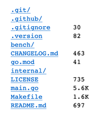

# srv

Serve a file or directory over HTTP. Directory listings are browsable, Markdown files render as HTML, and `--docs` opens a browser for a tree of Markdown files.



## Install

Download the archive for your operating system and CPU architecture from [GitHub releases](https://github.com/laputa-systems/srv/releases), then extract it. On macOS ARM64, for example:

```sh
unzip srv-aarch64-apple-darwin.zip
mkdir -p ~/.local/bin
install -m 755 srv-aarch64-apple-darwin ~/.local/bin/srv
```

Put `~/.local/bin` on your `PATH`. Linux archives use musl; choose the `-static` archive to avoid needing the musl dynamic loader.

## Use

```sh
srv [options] [path]
srv ./public
srv -p 8080 -b 127.0.0.1 ./public
srv --docs ./docs
```

With no path, `srv` serves the current directory at `http://127.0.0.1:8000`.

| Option | Effect |
| --- | --- |
| `path` | File or directory to serve; defaults to `.`. A selected file is returned for any URL path. |
| `-p` | Pass a port number; defaults to `8000`. |
| `-b` | Pass a bind address; defaults to `127.0.0.1`. |
| `--docs` | Browse Markdown files under the selected root (a selected file uses its parent directory); hidden directories and directories matched by simple `.gitignore` patterns are skipped. |
| `-q` | Suppress per-request logs. |
| `-h`, `--help` | Print usage. |
| `-V`, `--version` | Print the version. |

For a directory, `index.html` is served when present; otherwise `srv` shows a listing. `.md` and `.markdown` files render as HTML. Only GET requests are served. `srv` writes startup, request, and error messages to standard error; `-q` suppresses request messages.

Path traversal using `..` is rejected, but symlinked directories under the selected path can expose files outside it. Serve only directories whose symlinks you trust.

For help, use `srv --help` or [open an issue](https://github.com/laputa-systems/srv/issues). Licensed under [MIT](LICENSE).
